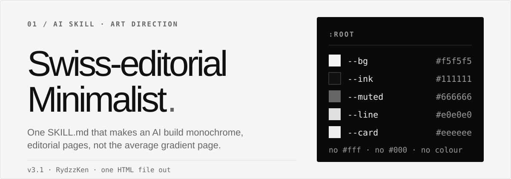
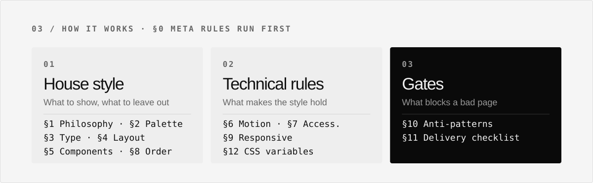
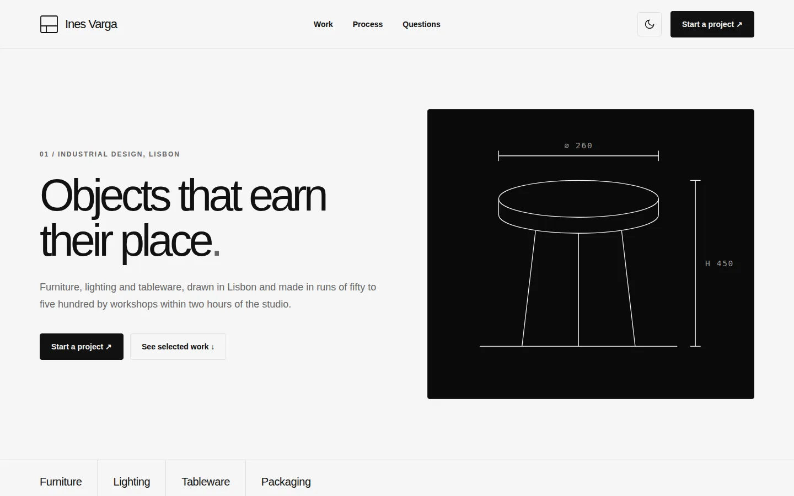
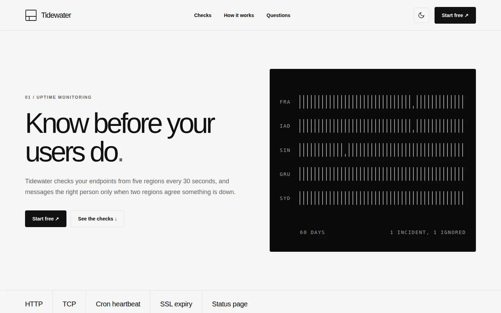
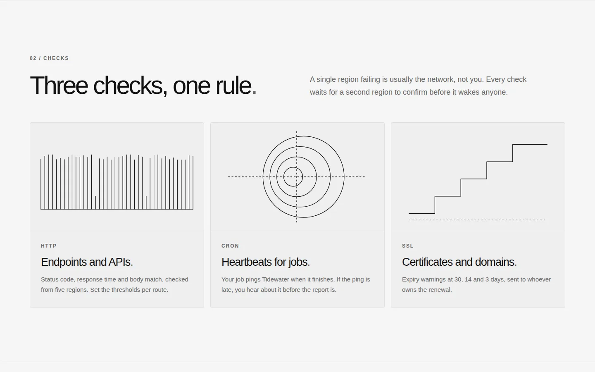
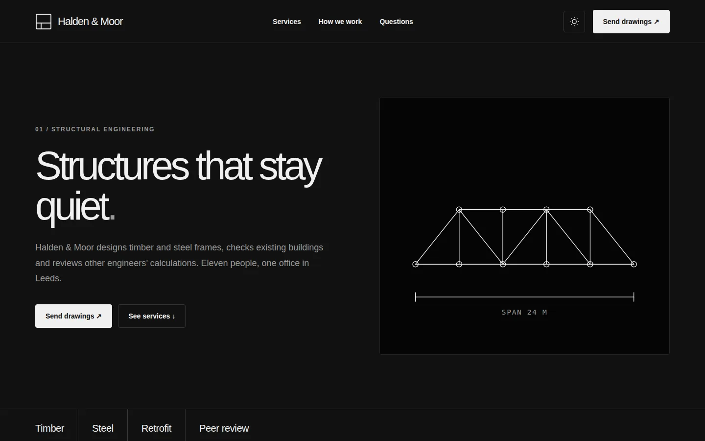

<p align="center">
  
</p>

<p align="center">
  
  &nbsp;
  
  &nbsp;
  <a href="CHANGELOG.md"></a>
</p>

**Swiss-editorial Minimalist** is an Agent Skill that makes coding agents build monochrome, editorial web pages instead of the average landing page: a gradient hero, rounded cards with emoji icons, a shadow under every button. It gives the agent fixed decisions (palette, type scale, grid, components, accessibility) and a checklist the page must pass before it ships.

What changes, row by row:

<p align="center">
  
</p>

Use it for landing pages, company profiles, portfolios, and dev-tool or AI startup pages that should read as Swiss, editorial, or monochrome.

## Install

```bash
npx skills add https://github.com/RydzzKen/swiss-editorial-minimalist --skill "swiss-editorial-minimalist"
```

That installs the skill with the [`npx skills`](https://github.com/vercel-labs/skills) CLI. It detects the coding agents on your machine and asks which ones to install for. Add `-g` to install for every project, or `-a claude-code` to pick one agent.

The skill is a single Markdown file. It runs no scripts, installs nothing, and needs no API keys.

<details>
<summary>List what the repo contains first</summary>

```bash
npx skills add https://github.com/RydzzKen/swiss-editorial-minimalist --list
```

</details>

<details>
<summary>Manual install (Claude Code)</summary>

Copy the skill folder into your project, or into `~/.claude/skills/` for every project:

```bash
git clone https://github.com/RydzzKen/swiss-editorial-minimalist
cp -r swiss-editorial-minimalist/skills/swiss-editorial-minimalist .claude/skills/
```

</details>

<details>
<summary>Chat without skill support</summary>

Attach [`SKILL.md`](skills/swiss-editorial-minimalist/SKILL.md) to the conversation and use the prompt under [Use it](#use-it).

</details>

Already have the skill? Run the install command again to update it.

## How it works

<p align="center">
  
</p>

The agent reads section 0 first. If your request conflicts with the house style (for example “colourful”, “playful”, “gradient hero”, “emoji icons”, “20px rounded cards”), it confirms once before building. Anything the file already decides, it does not ask you about. The result is one complete HTML file with inline CSS and JavaScript.

## What it looks like

Four pages built with this skill. No gradients, no shadows, no rounded cards.

<p align="center">
  
  
</p>
<p align="center">
  
  
</p>

*Pages built with the skill (source in [`examples/`](examples)): portfolio (light), landing page (light), feature grid, company profile (dark mode).*

## Use it

Paste this prompt and fill the brackets:

```text
Read the SKILL.md file I attached.

Build a [TYPE: portfolio / landing / company profile] for [NICHE]
called [NAME].

Sections needed:
1. Hero
2. [section 2]
3. [section 3]
...

Specific needs:
- [language]
- [additional section]
- [dark mode default]

Mandatory rules from SKILL.md (summary):
- Monochrome palette (#f5f5f5 / #111 / #666)
- Space Grotesk headings, weight 500, negative letter-spacing
- 1px var(--line) border as the section divider
- No border-radius above 4px, no shadows
- No bright colours (emerald/red/blue/yellow)
- No Tailwind CDN
- SVG line-art illustrations, not coloured photos
- Working dark mode toggle
- Responsive on mobile: nav → hamburger

Output: one complete HTML file (inline CSS + JS).
```

With the skill installed, you can skip the first line and the rules summary. Then check the page yourself at 320, 360, 768 and 1280 px, in light and dark mode.

## Style names

Ask for a variation by name. The skill keeps these terms fixed so the vocabulary stays consistent.

| Name | What changes |
| --- | --- |
| Swiss-editorial Minimalist | The default, described in the skill. |
| Soft Brutalism | Thicker borders and a rougher grid. |
| Neo-Brutalist Editorial | One accent colour and a hard offset shadow. Only on explicit request. |
| Monochrome Magazine | Typography-led, with no illustrated cards. |

## Common Questions

**What does the skill need?**  
Nothing beyond an agent that reads skills (or a chat where you can attach the file). Installing it with `npx` needs Node.js.

**Does it work with React, Vue, Svelte, plain HTML?**  
The default output is a single HTML file with vanilla CSS and `:root` variables. The Tailwind CDN is banned; Tailwind is allowed only with a build step. Say so in the prompt if you need a framework.

**Can I get colour, gradients or shadows?**  
Not in the default style. Asking for them triggers a one-time confirmation. The Neo-Brutalist Editorial variant adds one accent colour and a hard offset shadow when you ask for it by name.

**Which language is the page in?**  
The sample labels in the skill (skip link, footer line, status cards) are Indonesian. Set your language in the prompt.

**Does the checklist replace testing?**  
No. The agent runs the delivery checklist on its own work. Still open the page on a real phone.

## Feedback

Open an issue or pull request. Maintained by [RydzzKen](https://github.com/RydzzKen).
